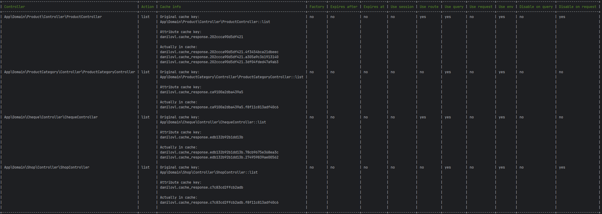

[](https://github.com/danilovl/cache-response-bundle/actions/workflows/phpunit.yml)
[](https://packagist.org/packages/danilovl/cache-response-bundle)
[](https://packagist.org/packages/danilovl/cache-response-bundle)
[](https://packagist.org/packages/danilovl/cache-response-bundle)

# CacheResponseBundle #

## About ##

This Symfony bundle provides simple response caching.

Before:


After:


### Requirements

* PHP 8.3 or higher
* Symfony 7.0 or higher

### 1. Installation

Install the `danilovl/cache-response-bundle` package with Composer:

``` bash
composer require danilovl/cache-response-bundle
```

Add the `CacheResponseBundle` to your application's bundles if it is not added automatically:

``` php
<?php
// config/bundles.php

return [
    // ...
    Danilovl\CacheResponseBundle\CacheResponseBundle::class => ['all' => true]
];
```

### 2. Usage

You can define a custom cache service which implements `CacheItemPoolInterface`.

Default cache service used for all attributes. You may leave it empty; the DI container will use the default service for `CacheItemPoolInterface` defined in your application.

```yaml
# config/packages/danilovl_cache_response.yaml

danilovl_cache_response:
  enable: true/false
  cache_adapter: 'Class::class'
  kernel_controller_priority: 0
  kernel_response_priority: 0
```

`CacheResponseAttribute` options:

```
| Parameter         | Type                   | Default | Required        | Description                                                             |
| ----------------- | ---------------------- | ------- | --------------- | ----------------------------------------------------------------------- |
| $key              | ?string                | null    |  yes || factory | A custom cache key. If null, a key will be generated automatically.     |
| $factory          | ?string                | null    |  yes || key     | The class of the factory used to generate the value.                    |
| $cacheAdapter     | ?string                | null    |  no             | The class of the cache adapter.                                         |
| $expiresAfter     | int|DateInterval|null  | null    |  no             | Time after which the value expires. Can be seconds or a DateInterval.   |
| $expiresAt        | ?DateTimeInterface     | null    |  no             | Exact expiration time for the value.                                    |
| $useSession       | bool                   | false   |  no             | Whether to include session data in the cache key generation.            |
| $useRoute         | bool                   | false   |  no             | Whether to include the current route in the cache key.                  |
| $useQuery         | bool                   | false   |  no             | Whether to include query parameters in the cache key.                   |
| $useRequest       | bool                   | false   |  no             | Whether to include full request data in the cache key.                  |
| $useEnv           | bool                   | false   |  no             | Whether to include environment variables in the cache key.              |
| $disableOnQuery   | bool                   | false   |  no             | Disable cache entirely if GET (query) parameters are present.           |
| $disableOnRequest | bool                   | false   |  no             | Disable cache entirely if POST (request body) parameters are present.   |
|--------------------------------------------------------------------------------------------------------------------------------------------------|
``` 

#### 2.1 Controller

Add the `CacheResponseAttribute` to a controller method.

```php
#[CacheResponseAttribute(
    key: 'index', 
    expiresAfter: 60, 
    useSession: true, 
    useRoute: true, 
    useQuery: true, 
    useRequest: true,
    useEnv: true
)]
public function index(Request $request): Response
{
    return new Response('content');
}
```

Or, a better solution if you have duplicate controller and method names.

```php
#[CacheResponseAttribute(
    key: __METHOD__, 
    expiresAfter: 60, 
    useQuery: true, 
    useRequest: true,
    useEnv: true
)]
public function index(Request $request): Response
{
    return new Response('content');
}
```

Use a custom factory service to create the cache key. It must implement the `CacheKeyFactoryInterface`.

```php
#[CacheResponseAttribute(factory: CacheKeyFactoryClass::class)]
public function index(Request $request): Response
{
    return new Response('content');
}
```

#### 2.2 Command

List all `CacheResponseAttribute` cache keys.

```bash
php bin/console danilovl:cache-response:list 
```



Clear all `CacheResponseAttribute` caches.

```bash
php bin/console danilovl:cache-response:clear --all=true
```

Clear only a specific `CacheResponseAttribute` cache key.

```bash
php bin/console danilovl:cache-response:clear --cacheKey=index
```

Clear all caches with similar `CacheResponseAttribute` cache key names.

```php
0 => "danilovl.cache_response.8414b2ff0a6fafcddc0f42d6d5a5b908d34925c3"
1 => "danilovl.cache_response.8414b2ff08997b2bd029eaab1a04598a500a0034"
```

```bash
php bin/console danilovl:cache-response:clear --similarCacheKey=8414b2ff0
```

```php
0 => "danilovl.cache_response.5f9cf7121290f93c"
1 => "danilovl.cache_response.a202b43aa495f0f3"
```

```bash
php bin/console danilovl:cache-response:clear --cacheKey=similar
```

#### 2.3 Event Subscriber

Clear all caches.

```php
$this->eventDispatcher->dispatch(new ClearCacheResponseAllEvent);
```

Clear only a specific cache key.

```php
$this->eventDispatcher->dispatch(new ClearCacheResponseKeyEvent('cache_key'));
```

## License

The CacheResponseBundle is open-sourced software licensed under the [MIT license](https://opensource.org/licenses/MIT).
